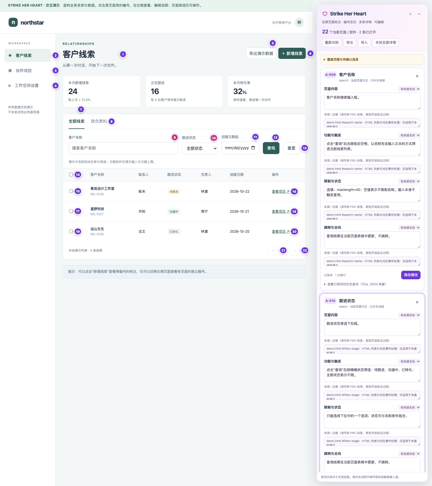

# Strike Her Heart

**在 Codex 中运行的独立页面标注 agent：理解页面，把说明放回原页面。**

在 Codex 中调用 **Strike Her Heart**，提供 PRD、原型、截图或系统地址。它负责理解资料、发现页面与状态、逐个识别控件、生成有依据的解释，并通过当前环境支持的执行工具呈现标注、修改内容和验证保存。

目标交付是在原页面的按钮、输入框、选择器等控件旁显示 **`A-001` 编号气泡**。点击气泡后，右侧列出可编辑的详情；可以同时打开多条，按编号修改，保存后保留人工修订。说明文档用于辅助，不能代替原页面上的标注。

下图是仓库内虚构业务演示的运行时预览：原页面保留编号，右侧同时打开两条可编辑详情。它展示渲染器效果，不代表外部系统或独立 agent 的端到端验收。



## 快速开始

需要支持自定义 agent 的 Codex 环境，以及 Python 3.9 或更新版本。agent 使用父会话已有的模型、工具与权限，不需要单独配置 OpenAI API Key。

```bash
git clone https://github.com/sakura1412/strike-her-heart.git
cd strike-her-heart
python3 scripts/install.py
```

安装器分别写入：

```text
~/.codex/agents/strike-her-heart.toml   # 独立自定义 agent
~/.codex/skills/strike-her-heart/      # 实施支持资源
```

如果设置了 `CODEX_HOME`，安装位置随该目录变化。已有同名安装时默认拒绝覆盖；更新使用 `python3 scripts/install.py --update`，旧版本会先备份至 Codex 的 `backups` 目录。安装器只处理 Strike Her Heart 的目标文件。

更新前会核对已安装资源的身份；其他名称或无法确认身份的 agent／Skill 会被拒绝覆盖。支持目录在备份后整体替换，以移除旧版残留文件；本地自定义内容可从备份取回。

安装后新建一个 Codex 会话，明确调用：

```text
请调用名为 Strike Her Heart 的自定义 agent，标注这个系统：
https://example.com

请发现当前账号可访问的页面、页签和安全可打开的弹窗。
每个按钮、输入框、选择器都放编号气泡；点击后在右侧显示
内容、功能、限制、跳转说明，支持编辑、保存和刷新核验。
```

有资料时继续提供，无须换入口：

```text
这是本次 PRD 和原型，请结合实际系统标注。
资料未说明、无法观察确认的规则，请明确标为待确认。
```

后续可以直接按页面和编号修改：

```text
调用 Strike Her Heart，把线索列表页 A-012 的限制说明改为：
“仅管理员可使用；权限来源仍需核对。”
保留原始依据和修订记录，保存后重新打开该条确认。
```

Codex 的自定义 agent 目录、必需字段与权限继承方式见 [OpenAI 官方文档](https://learn.chatgpt.com/docs/agent-configuration/subagents)。配置安装成功与 agent 已被实际调度，是两个需要分别确认的状态。

## Agent、Skill 和页面执行工具

| 组成 | 作用 | 入口 |
| --- | --- | --- |
| **Strike Her Heart** | 接手页面标注任务，负责理解、规划、工具选择、执行与验收 | 在 Codex 中点名调用自定义 agent |
| **实施支持 Skill** | 提供控件映射、证据规则、运行时代码和验收方法 | 由 agent 读取；也可显式调用 `$strike-her-heart` |
| **DOM 标注运行时** | 在受支持的原页面显示气泡、右侧详情、编辑及保存 | 由 agent 选择已获授权的接入方式 |

`$strike-her-heart` 只选择实施支持 Skill，不能作为独立 agent 已启动的证明。本 agent 与原有“标记／标注”Skill 独立，不要求安装后者，也不会替换它。

浏览器和渲染器是执行工具。浏览器扩展仅是用户对当前任务明确选用时的一种可选执行器，**不是默认安装要求，也不是 agent 的调用入口**。

## 标注包含什么

每个控件分别说明四项信息，并保留各字段的依据和确认状态：

| 字段 | 说明示例 |
| --- | --- |
| 内容 | 页面或控件展示什么，当前名称与状态是什么 |
| 功能 | 用户操作会触发什么；哪些行为已实际观察 |
| 限制 | 必填、长度、可选值、权限、禁用条件；未核实规则明确保留缺口 |
| 跳转 | 当前可观察的链接、路由或目标页面；是否实际访问验证 |

覆盖对象包括按钮、图标按钮、输入框、文本域、选择器、复选框、单选框、开关、日期、上传、链接、页签、菜单项与可操作表格控件。页面标题、提示、状态和业务区块也可以补充说明；区块标注不能替代内部控件。

编号与数据以页面、状态和控件身份关联。重新识别、排序及刷新时复用已有编号；人工修改保留原始证据和历史版本。新资料与人工字段冲突时，呈现建议或待复核状态，不静默覆盖。

## 从输入到验收

1. **读取资料与确认能力**：复用已提供的 PRD、原型、目标范围和登录会话，确认当前工具能否读取页面、写回原页。
2. **发现页面与状态**：建立页面、页签、弹窗及安全可访问状态的清单，记录已访问、已标注与未完成项。
3. **逐控件解释**：结合资料与实际观察生成说明；缺失、冲突和无法核实的信息逐字段标记。
4. **在原页呈现**：通过受支持的接口或获授权的项目集成，显示编号气泡和右侧可编辑详情。
5. **编辑与保存验收**：检查多条详情打开、修改后刷新、路由与弹窗隔离、滚动缩放、关闭后的原交互，以及人工修订保留。

只有系统地址也能开始。只有 PRD 时可以先提取页面与控件清单，但还需要实际目标才能完成原页标注。只有截图时可以按原图制作坐标标注预览，并明确它属于原画面预览。

## 页面接入与能力边界

自定义 agent 继承 Codex 父会话的工具和权限。注册名称不会自动赋予向任意网站写入脚本的能力。

- **有项目源码**：在已获授权的目标项目中接入随附运行时，并验证路由、卸载和原有交互。
- **有正式页面写入能力**：通过当前受支持的浏览器、连接器或站点接口完成接入与验收。
- **只有读取能力**：继续页面发现、证据整理和待接入映射，同时明确原页写入尚未完成；不能把只读接口用于脚本注入。
- **截图、Canvas、跨域 iframe、封闭 Shadow DOM 或非标准控件**：按目标提供适配或原画面定位，不能宣称 DOM 扫描已经覆盖其内部。

随附运行时会扫描可见原生控件与常用 ARIA 控件，提取标签、类型、声明约束和链接信息。业务规则的理解与核对仍由 agent 完成；隐藏状态、未访问页面及未确认目标保持未完成。

详细 API、接入方案、覆盖限制和可选执行器见 [运行时参考](skills/strike-her-heart/references/runtime.md)。SGE 适配器依据 2026-10-26 的公开页面观察实现；网站变化后仍需在实际目标逐次核验。

## 保存与数据

agent 在任务工作区保留页面清单、证据、控件映射、人工修订备份和待完成项。具体页面标注按实际执行器保存。

随附 DOM 运行时默认使用当前浏览器、当前站点的 `localStorage`，支持 JSON 导出与导入，没有自动上传或跨设备同步。同源页面脚本可以访问该存储；需要其他隔离或共享方式时使用目标正式数据层。原表单输入值、密码不进入运行时标注导出。

登录信息仅用于用户授权目标的正常认证，不写入脚本、标注、日志、导出或仓库。验证码及二次认证由用户完成该一步。标注任务默认不执行真实提交、删除、付款、审批或对外发送。

## 开发与测试

agent 配置与安装脚本不依赖 Node.js。修改页面渲染器时，使用 Node.js 20 或更新版本和 Playwright：

```bash
npm ci
npx playwright install chromium
npm test
```

已有本机 Chrome 时也可设置 `SHH_BROWSER_CHANNEL=chrome`；自定义浏览器路径可通过 `SHH_BROWSER_EXECUTABLE` 指定。测试使用临时浏览器上下文和虚构演示／模拟页面，自动启动需要的本地服务，不使用个人浏览器配置或登录会话。产物写入被 Git 忽略的 `test-results/`。

查看虚构业务演示：

```bash
python3 -m http.server 8767 --bind 127.0.0.1 --directory skills/strike-her-heart/assets
# 在浏览器打开 http://127.0.0.1:8767/demo.html
```

当前验证分为不同层级：

- 已验证 Codex 能加载并识别该自定义 agent 配置。
- 渲染器有编号、右栏、多条详情、保存刷新、人工修订保护、状态隔离和 SGE 模拟适配的自动化测试。
- 本次发布按上述公开安装流程，在 Playwright Chromium 151.0.7922.34 上运行 **22 项测试，全部通过**；完整虚构演示涵盖 6 个状态、76 个控件和 82 个气泡实例。
- 最新独立 agent 的完整启动检查因模型请求超时未完成；尚不宣称它的端到端任务流程全部通过。
- 演示或模拟页面测试不能代替实际目标的逐页验收。

## 目录

```text
agents/strike-her-heart.toml          独立 agent 定义
skills/strike-her-heart/
  SKILL.md                           实施支持规范
  agents/openai.yaml                 支持 Skill 的展示与显式调用设置
  references/                        证据、接入、保存与验收方法
  assets/overlay.js                  页面气泡与右侧编辑运行时
  assets/demo*                       虚构业务演示与示例说明
  assets/site-adapters/              目标页面适配
  assets/extension/                  可选执行器源码
  scripts/build-extension.py         可选执行器构建脚本
scripts/install.py                   安装 agent 与支持资源
tests/                              隔离演示及模拟页面测试
```
