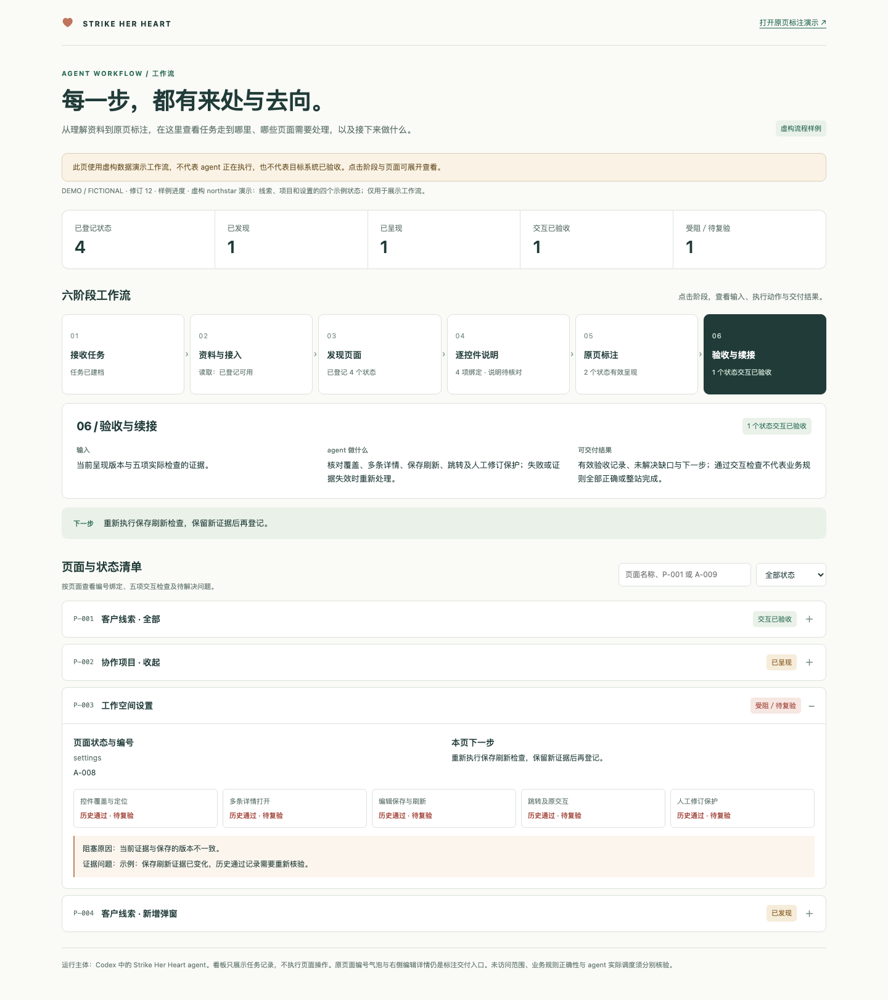
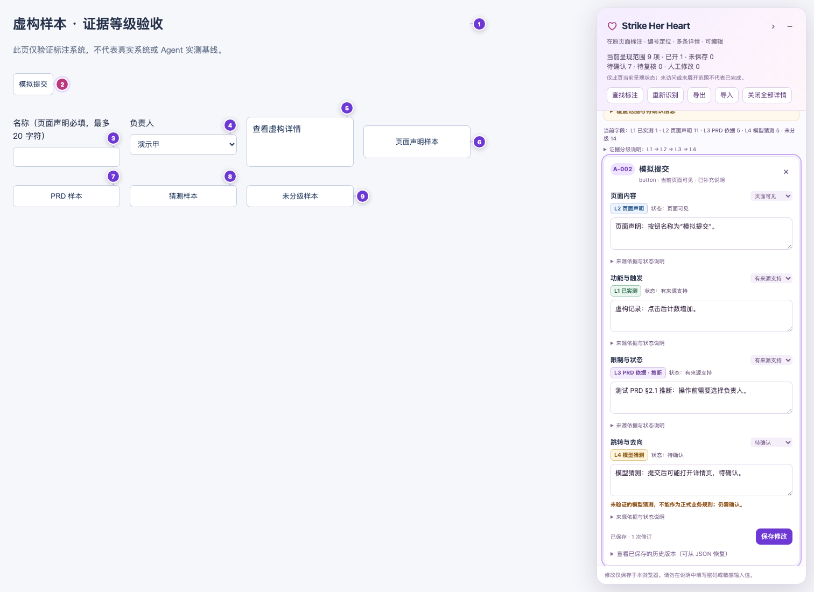
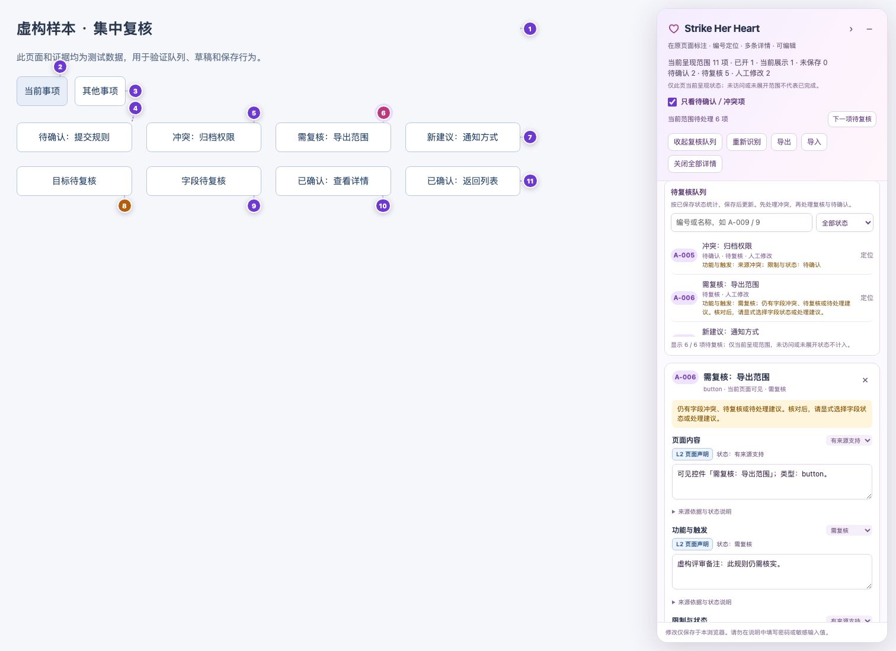

# Strike Her Heart

**在 Codex 中运行的独立页面标注 agent：理解页面，把说明放回原页面。**

当前版本为 **1.7.0**，以有条件约束的任务状态机和可恢复执行记录推进页面标注；保留右侧复核队列、逐字段证据分级、任务续接与保存保护，并附独立的 Agent 效果评估集。

在 Codex 中调用 **Strike Her Heart**，提供 PRD、原型、截图或系统地址。它负责理解资料、发现页面与状态、逐个识别控件、生成有依据的解释，并通过当前环境支持的执行工具呈现标注、修改内容和验证保存。

目标交付是在原页面的按钮、输入框、选择器等控件旁显示 **`A-001` 编号气泡**。点击气泡后，右侧列出可编辑的详情；可以同时打开多条，按编号修改，保存后保留人工修订。说明文档用于辅助，不能代替原页面上的标注。

下图是仓库内虚构业务演示的运行时预览：原页面保留编号，右侧同时打开两条可编辑详情。它展示渲染器效果，不代表外部系统或独立 agent 的端到端验收。


## Agent 工作流

你提供资料或系统地址，Strike Her Heart 在 Codex 中推进下面六个阶段。开始、阶段切换、受阻和交付时，agent 会说明当前阶段、已有结果与下一步，并更新任务工作流快照。

```mermaid
flowchart TD
    subgraph 正常阶段：每次推进均需实际记录与有效证据
    A[intake 接收任务] --> B[access 资料与接入]
    B --> C[discovery 发现页面并确认范围]
    C --> D[annotation 逐控件说明与真实编号绑定]
    D --> E[presentation 原页标注]
    E --> F[acceptance 验收与缺口解决]
    end
    F -->|全部完成条件通过并显式登记| G[completed 明确范围内完成]
    H[任一活动阶段] -->|缺条件| I[blocked 受阻]
    H -->|实际执行未通过| J[failed 失败]
    H -->|用户明确终止| K[cancelled 取消]
    I -->|补齐条件并显式 resume| L[回到受阻前阶段]
    J -->|修复并显式 retry| L
    K -->|显式 reopen| M[重新接收任务或重新发现页面]
    G -->|新任务变更需 reopen| M
```

| 阶段 | agent 执行动作 | 用户可看到的结果 |
| --- | --- | --- |
| 接收任务 | 复用资料，建立或恢复同一任务 | 目标范围、任务 ID、当前修订 |
| 资料与接入 | 读取资料，核对读取与写入能力 | 已有能力、接入缺口 |
| 发现页面 | 遍历获授权的页面与安全状态 | 页面／状态清单及稳定页面 ID |
| 逐控件说明 | 结合资料解释每个控件，保留未知与冲突 | 内容、功能、限制、跳转、来源及编号映射 |
| 原页标注 | 在原页呈现编号气泡及右侧详情 | 可打开、编辑、保存的说明 |
| 验收与续接 | 核对覆盖、多开、保存刷新、跳转和人工修订保护 | 有依据的检查结果、缺口、下一步 |

每个阶段及异常状态都有 **进入条件、成功条件、失败去向、允许的下一步**，由记录工具校验并显示在看板中。正常流程不能跳步；仅有绑定数、页面计数或一份总结，不会使阶段变成成功。

| 状态 | 含义与退出要求 |
| --- | --- |
| `blocked` 受阻 | 条件缺失或证据失效；记录原因与可执行下一步，补齐后凭实际证据显式恢复 |
| `failed` 失败 | 已实际执行但结果未通过；保留失败证据，修复后显式重试，旧检查不会自动通过 |
| `cancelled` 取消 | 用户明确终止；冻结普通修改、保留历史，只能显式重开，取消页不计为成功 |
| `completed` 范围内完成 | 逐阶段证据有效、明确范围清单未变、每页五项检查通过、业务缺口均有证据解决，并显式提交完成 |

完成后的证据若被删改，当前有效状态会显示为受阻，保留历史完成状态供回查。旧任务没有执行状态记录时显示待补核，不从“所有页面已验收”推断已完成。`taskComplete` 只指明确范围；`wholeSystemComplete` 始终为 false。完整状态契约、恢复和重试命令见 [状态与转移协议](skills/strike-her-heart/references/task-workflow.md)。

### 查看工作流

启动本地演示后，打开 [工作流看板](http://127.0.0.1:8768/workflow.html)，或点击原页演示顶部的“查看 agent 工作流”。顶部显示当前执行状态、原因、恢复方式及未满足的完成条件；点击六阶段可查看输入、动作、产出及状态契约，也可展开全部状态定义。页面清单支持已发现、已呈现、交互已验收、受阻、失败与取消筛选，并能查看五项检查与业务缺口。演示入口明确使用虚构数据。



真实任务中直接对 Codex 说：

```text
调用 Strike Her Heart，展示当前任务的工作流、各页面进度和下一步。
```

agent 会读取当前私有任务记录，运行 `task.py workflow --task-dir TASK_DIR`，生成并提供 `workflow.html`。它是带修订号和生成时间的**任务快照**；进度变化后由 agent 重新生成，浏览器刷新不自动读取新记录。无需你手工填写进度或维护 JSON。

工作流看板与原页标注配合使用。只统计已登记范围，未发现与未访问范围仍未知；编号绑定数不表示业务理解完成率，交互验收通过也不表示业务规则全部正确或整站完成。协议见 [任务记录与续接](skills/strike-her-heart/references/task-workflow.md)。

### 长任务中断与续跑

对于已登记页面的说明、原页呈现和验收阶段，agent 使用页面工作队列与控件检查点。看板可查看待执行、运行中、退避等待、需人工、需复核、失败、已完成和取消状态，以及尝试次数、下一次重试时间与检查点数量。

每次续跑都要重新读取页面和控件清单；内容或映射变化会使受影响检查点失效。执行租约拒绝超时或旧 worker 的迟到结果，任务取消后重开也不能复用旧租约。默认最多尝试 3 次，指数退避从 2 秒开始、最多 60 秒，单次租约 120 秒；这些上限可为新工作项配置。

网络或模型超时只在只读或明确幂等的操作中自动安排有限重试。登录过期、权限不足、验证码、定位变化和副作用未知需要人工处理或复核；耗尽后不循环重试。队列工具负责发放执行单和验证上报，浏览器及模型调用仍由 Codex agent 执行；它不是后台守护进程，不会自动唤醒已结束的会话。具体协议和命令见 [可恢复执行](skills/strike-her-heart/references/reliable-execution.md)。

### 身份、来源与完成验证

控件身份记录页面、状态、元素、定位和内容摘要及匹配置信度。列表重排、插入按钮和复用弹窗时，只有身份唯一匹配才继承旧编号与人工说明；无法确定的记录保留待复核。导入会先匹配身份再合并。

`claimRecords` 将说明片段与文字哈希、控件指纹和 `claimSources` 引用关联；来源区分 DOM 观察、实际交互、文档规定、推断和未知。DOM 属性只能支持页面声明，不能自动证明权限、服务端限制或操作后果。来源记录和文件哈希可检查一致性，解释是否真正被证据支持仍需人工或 agent 核对。

完成前由 agent 在真实保存和刷新前后采集运行时快照，`task.py verify` 独立核对页面、控件、持久化内容、人工修改、来源、冲突和报告数量。保存失败或验证缺失时 `taskComplete` 为 false。快照仍依赖实际执行者采集，不能独立证明观察真实或补全未发现页面。

`performAction` 只提供读取、扫描与当前页标注写入，默认拒绝业务提交、删除、审批、对外发送和任意点击。它只控制经过此接口的操作，不能拦截 Codex 会话继承的其他浏览器工具；这些工具仍须遵循用户授权和项目操作边界。接口与完整协议见 [可恢复执行](skills/strike-her-heart/references/reliable-execution.md)。

## 快速开始

需要支持自定义 agent 的 Codex 环境，以及 Python 3.9 或更新版本。agent 使用父会话已有的模型、工具与权限，不需要单独配置 OpenAI API Key。

```bash
git clone https://github.com/sakura1412/strike-her-heart.git
cd strike-her-heart
python3 scripts/install.py
```

安装器分别写入：

```text
~/.codex/agents/strike-her-heart.toml   # 独立自定义 agent
~/.codex/skills/strike-her-heart/      # 实施支持资源
```

如果设置了 `CODEX_HOME`，安装位置随该目录变化。已有同名安装时默认拒绝覆盖；更新使用 `python3 scripts/install.py --update`，旧版本会先备份至 Codex 的 `backups` 目录。安装器只处理 Strike Her Heart 的目标文件。

更新前会核对已安装资源的身份；其他名称或无法确认身份的 agent／Skill 会被拒绝覆盖。支持目录在备份后整体替换，以移除旧版残留文件；本地自定义内容可从备份取回。

安装后新建一个 Codex 会话，明确调用：

```text
请调用名为 Strike Her Heart 的自定义 agent，标注这个系统：
https://example.com

请发现当前账号可访问的页面、页签和安全可打开的弹窗。
每个按钮、输入框、选择器都放编号气泡；点击后在右侧显示
内容、功能、限制、跳转说明，支持编辑、保存和刷新核验。
```

有资料时继续提供，无须换入口：

```text
这是本次 PRD 和原型，请结合实际系统标注。
资料未说明、无法观察确认的规则，请明确标为待确认。
```

后续可以直接按页面和编号修改：

```text
调用 Strike Her Heart，把线索列表页 A-012 的限制说明改为：
“仅管理员可使用；权限来源仍需核对。”
保留原始依据和修订记录，保存后重新打开该条确认。
```

Codex 的自定义 agent 目录、必需字段与权限继承方式见 [OpenAI 官方文档](https://learn.chatgpt.com/docs/agent-configuration/subagents)。配置安装成功与 agent 已被实际调度，是两个需要分别确认的状态。

## Agent、Skill 和页面执行工具

| 组成 | 作用 | 入口 |
| --- | --- | --- |
| **Strike Her Heart** | 接手页面标注任务，负责理解、规划、工具选择、执行与验收 | 在 Codex 中点名调用自定义 agent |
| **实施支持 Skill** | 提供控件映射、证据规则、运行时代码和验收方法 | 由 agent 读取；也可显式调用 `$strike-her-heart` |
| **DOM 标注运行时** | 在受支持的原页面显示气泡、右侧详情、编辑及保存 | 由 agent 选择已获授权的接入方式 |

`$strike-her-heart` 只选择实施支持 Skill，不能作为独立 agent 已启动的证明。本 agent 与原有“标记／标注”Skill 独立，不要求安装后者，也不会替换它。

浏览器和渲染器是执行工具。浏览器扩展仅是用户对当前任务明确选用时的一种可选执行器，**不是默认安装要求，也不是 agent 的调用入口**。

## 1.2.0 的改进

- **任务可续接**：agent 使用私有任务记录保存页面／状态、已确认接入能力、实际编号绑定、验收证据和下一步。再次说“继续上次”时读取同一记录；用户无需维护 JSON。
- **质量可处理**：右栏直接开启“只看待确认／冲突项”，优先处理来源冲突、需复核及待确认记录；使用“下一项待复核”逐条定位。可继续按编号、名称、状态和证据等级查找。计数只针对当前呈现范围。
- **核心说明优先**：内容、功能、限制、跳转直接可编辑，来源依据按需展开；已打开多条详情时仍可进入查找目录。
- **修改与证据分别表达**：润色冲突字段会保留冲突提示，明确改变证据状态后才解除；人工内容继续受重扫和导入保护。
- **保存反馈可信**：存储失败保留草稿、提示重试，不将失败写入显示为已保存。

任务记录由 [task.py](skills/strike-her-heart/scripts/task.py) 管理，协议与验收门槛见 [任务记录与续接](skills/strike-her-heart/references/task-workflow.md)。脚本校验记录结构、修订和推进条件；实际页面及证据仍由 agent 核验，不能仅凭登记动作证明已运行或已验收。

## 标注包含什么

每个控件分别说明四项信息，并保留各字段的依据和确认状态：

| 字段 | 说明示例 |
| --- | --- |
| 内容 | 页面或控件展示什么，当前名称与状态是什么 |
| 功能 | 用户操作会触发什么；哪些行为已实际观察 |
| 限制 | 必填、长度、可选值、权限、禁用条件；未核实规则明确保留缺口 |
| 跳转 | 当前可观察的链接、路由或目标页面；是否实际访问验证 |

### 证据等级在 UI 中直接可见

每个字段旁都有等级编号与文字标识，颜色作辅助；来源类型、确认状态与人工修改分别保存。

| 分级 | 标识与含义 | 示例 |
| --- | --- | --- |
| **L1 已实测** | 记录了真实动作、结果、时间和来源定位 | 实际保存后刷新，读到相同编号与修改内容 |
| **L2 页面声明** | DOM、页面属性或可读取源码支持的声明 | `required`、`maxlength=40`、`href`；尚未据此认证后端行为 |
| **L3 PRD 依据** | 明确区分“直接定义”和“推断” | PRD 规定权限；由资料推导的解释注明推断 |
| **L4 模型猜测** | 显式假设，持续保持待确认 | 资料缺失时用户要求保留的待验证假设 |
| **未分级** | 当前来源不足或旧记录尚待核对 | 旧版仅写“有依据”，无法确定其来源方法 |

展开字段的来源区域，可查看和编辑来源、定位、动作、结果、时间及 PRD 推导方式，也可以在目录中按等级筛选。L1 记录不完整不能保存为已实测；L2／L3 需要来源与定位。外部导入缺少必要证据时降为未分级并待复核。

证据等级不自动裁决来源冲突。一次点击只支持本次条件下的结果；PRD 与页面不一致仍要保留双方。人工修改不提升等级，已实测文字改动后进入复核；混合来源的同一字段按最弱适用等级展示。运行时能核对记录结构，证据是否真实仍由 agent 或复核者确认。

旧版 `observed` 原指页面可见，只迁为 L2；旧版 `supported`／`user` 等无法辨明来源的记录保持未分级，原编号、文字、证据与人工修订不丢失。数据继续使用 `schemaVersion: 1`，新增 `evidenceMeta`，详细字段见 [证据协议](skills/strike-her-heart/references/annotation-evidence.md)。

下面为隔离测试中的**虚构分级展示样本**，用于展示四种徽标与右侧详情；其中的实测记录是测试数据，不是对真实业务系统的验证结论。



### 集中处理待确认和冲突

右侧顶部的 **“只看待确认／冲突项”** 开关会显示当前页面状态的待复核队列，并筛选已打开的详情。
队列合并待确认、来源冲突、需复核、待处理建议及控件定位复核，按控件去重；来源冲突优先，其次是其他复核项，最后是待确认项。同一优先级按原编号排列，每项列出待处理字段或原因。

点击队列条目或 **“下一项待复核”** 可定位原控件并打开详情，不触发业务操作。编号／名称搜索及原有状态、证据等级筛选可以继续组合使用，“下一项”只遍历筛选匹配项，无匹配时禁用。L1 等级仍有冲突时会留在队列，来源等级不换算成模型正确率。

队列依据已保存的状态更新：编辑中的条目会保留，成功保存并解决全部待处理原因后才退出；保存失败仍保留原记录与草稿。开启筛选前已打开的其他未保存草稿也会暂留并明确提示，关闭筛选可恢复已打开详情。直接点击无需复核的原页气泡会退出筛选并显示该条说明。

开关按页面、页签及弹窗分别保存在当前会话，刷新后恢复默认。没有匹配项时只表示**当前呈现范围**没有待处理记录，不能据此推断未访问页面已验收。

下面使用虚构评审记录展示队列和原页定位，供界面验收参考：



覆盖对象包括按钮、图标按钮、输入框、文本域、选择器、复选框、单选框、开关、日期、上传、链接、页签、菜单项与可操作表格控件。页面标题、提示、状态和业务区块也可以补充说明；区块标注不能替代内部控件。

编号与数据以页面、状态和控件身份关联。重新识别、排序及刷新时复用已有编号；人工修改保留原始证据和历史版本。新资料与人工字段冲突时，呈现建议或待复核状态，不静默覆盖。

## 从输入到验收

1. **读取资料与确认能力**：复用已提供的 PRD、原型、目标范围和登录会话，确认当前工具能否读取页面、写回原页。
2. **发现页面与状态**：建立页面、页签、弹窗及安全可访问状态的清单，记录已访问、已标注与未完成项。
3. **逐控件解释**：结合资料与实际观察生成说明；缺失、冲突和无法核实的信息逐字段标记。
4. **在原页呈现**：通过受支持的接口或获授权的项目集成，显示编号气泡和右侧可编辑详情。
5. **编辑与保存验收**：检查多条详情打开、修改后刷新、路由与弹窗隔离、滚动缩放、关闭后的原交互，以及人工修订保留。

只有系统地址也能开始。只有 PRD 时可以先提取页面与控件清单，但还需要实际目标才能完成原页标注。只有截图时可以按原图制作坐标标注预览，并明确它属于原画面预览。

## 页面接入与能力边界

自定义 agent 继承 Codex 父会话的工具和权限。注册名称不会自动赋予向任意网站写入脚本的能力。

- **有项目源码**：在已获授权的目标项目中接入随附运行时，并验证路由、卸载和原有交互。
- **有正式页面写入能力**：通过当前受支持的浏览器、连接器或站点接口完成接入与验收。
- **只有读取能力**：继续页面发现、证据整理和待接入映射，同时明确原页写入尚未完成；不能把只读接口用于脚本注入。
- **截图、Canvas、跨域 iframe、封闭 Shadow DOM 或非标准控件**：按目标提供适配或原画面定位，不能宣称 DOM 扫描已经覆盖其内部。

随附运行时会扫描可见原生控件与常用 ARIA 控件，提取标签、类型、声明约束和链接信息。业务规则的理解与核对仍由 agent 完成；隐藏状态、未访问页面及未确认目标保持未完成。

详细 API、接入方案、覆盖限制和可选执行器见 [运行时参考](skills/strike-her-heart/references/runtime.md)。SGE 适配器依据 2026-10-26 的公开页面观察实现；网站变化后仍需在实际目标逐次核验。

## 保存与数据

agent 在任务工作区保留页面清单、证据、控件映射、人工修订备份和待完成项。具体页面标注按实际执行器保存。

随附 DOM 运行时默认使用当前浏览器、当前站点的 `localStorage`，支持 JSON 导出与导入，没有自动上传或跨设备同步。同源页面脚本可以访问该存储；需要其他隔离或共享方式时使用目标正式数据层。原表单输入值、密码不进入运行时标注导出。

登录信息仅用于用户授权目标的正常认证，不写入脚本、标注、日志、导出或仓库。验证码及二次认证由用户完成该一步。标注任务默认不执行真实提交、删除、付款、审批或对外发送。

## 开发与测试

### Agent 效果评估

项目现包含独立的 [Agent 评估集与评分协议](evals/README.md)：每个合成样本由 **页面 HTML + PRD + 期望标注** 组成，覆盖原生约束、PRD 独有规则、跳转、禁用状态、来源冲突、未知规则、已打开弹窗、同名控件与不可信页面文本。

评分分别报告 **控件召回率、说明准确率、幻觉率**，并补充控件精确率与有据说明覆盖率，避免“只输出少量正确内容”获得虚高分数。事实依据为页面与 PRD 的并集；资料冲突应明确保留，未定义的规则不能凭控件名称补写。

控件匹配由脚本计数；自由文本说明采用独立人工或模型的逐字段、逐断言评审，再由评分器核对引用、必要事实覆盖、完整原文与分母。没有完整评审时语义分数保持未完成，不能显示为零幻觉。评分器自测、渲染器测试与实际 agent 效果报告分别记录。

```bash
npm run eval:prepare -- --output /tmp/shh-eval-inputs
# 在新上下文中调用 Strike Her Heart，只提供输入包；冻结实际 predictions.json。
# 独立评审对照标准答案生成 review.json，再计算指标：
npm run eval:score -- --predictions /tmp/shh-eval-inputs/predictions.json \
  --review /tmp/shh-eval-review.json --output /tmp/shh-eval-report.json --strict
```

此合成集是公开开发集，标准答案仍需外部专家校准；不能将单次小样本结果当作真实系统准确率。具体分母、数据隔离、评审格式及结果边界见 [评估说明](evals/README.md)。

[首轮实际运行基线](evals/results/2026-10-27-run-01/README.md) 已保存：真实调用命名 Strike Her Heart 后，24/24 控件命中，90/96 字段按严格标准完整正确，独立模型评审未发现无依据／矛盾断言（0/297）。**开发门槛未通过**：93.75% 低于 95%；六项扣分涉及事实放置在其他字段，报告明确区分字段协议问题与幻觉。原始输出、评审和新旧标准版本均可复核，未反改候选提高分数。

### 渲染器与本地工具测试

agent 配置与安装脚本不依赖 Node.js。修改页面渲染器时，使用 Node.js 20 或更新版本和 Playwright：

```bash
npm ci
npx playwright install chromium
npm test
python3 -m unittest discover -s tests -p 'test_*.py'
```

已有本机 Chrome 时也可设置 `SHH_BROWSER_CHANNEL=chrome`；自定义浏览器路径可通过 `SHH_BROWSER_EXECUTABLE` 指定。测试使用临时浏览器上下文和虚构演示／模拟页面，自动启动需要的本地服务，不使用个人浏览器配置或登录会话。产物写入被 Git 忽略的 `test-results/`。

查看虚构业务演示：

```bash
python3 scripts/serve.py
# 在浏览器打开 http://127.0.0.1:8768/demo.html#/leads
# 工作流看板：http://127.0.0.1:8768/workflow.html
```

当前验证分为不同层级：

- 已验证 Codex 能加载并识别该自定义 agent 配置。
- 渲染器有编号、右栏、多条详情、保存刷新、人工修订保护、状态隔离和 SGE 模拟适配的自动化测试。
- 基线 1.1.1 按上述公开安装流程，在 Playwright Chromium 151.0.7922.34 上运行 **22 项测试，全部通过**；完整虚构演示涵盖 6 个状态、76 个控件和 82 个气泡实例。
- 1.2.0 已完成本地验证：浏览器回归 **28/28**、任务记录与续接 **9/9**、本地预览服务 **7/7** 通过，共 **44 项自动化检查**。本机安装文件已与源码核对一致，Codex 调度工具已加载 agent 配置。
- 1.3.0 工作流版本：浏览器检查 **34/34**、Python 检查 **23/23** 通过，共 **57 项**。新增覆盖工作流阶段切换、页面检索与筛选、历史证据失效、只读快照与修订保持、文本安全及 390px 窄屏；原有六状态原页标注回归通过。
- 加入效果评估工具后，浏览器检查 **35/35**、Python 检查 **47/47** 通过，共 **82 项工程检查**，其中包含标准控件与实际渲染状态核对、19 项评分器契约检查。工程检查数量不是 agent 效果分数。
- 1.4.0 证据分级版本：原有 **35 项**浏览器回归和新增 **16 项**证据检查均通过，Python **47/47** 通过，共 **98 项工程检查**。覆盖旧记录迁移、来源完整性、实测改文复核、人工来源保护、建议采纳、保存／导入失败回滚、筛选及 390px 显示。六状态演示仍通过 76 个控件、82 个气泡实例、6 次保存刷新及原交互检查；这些结果不代表证据真实性或 Agent 说明准确率。
- 1.5.0 复核队列版本：原有 **51 项**浏览器回归与新增 **9 项**队列检查通过，Python **47/47** 通过，共 **107 项工程检查**。新检查覆盖当前范围去重与排序、搜索筛选交集、下一项定位、草稿暂留、保存失败、已确认气泡打开、路由／页签隔离及 390px 显示；证据标准与历史 Agent 效果基线没有改动。
- 1.7.0 本地验证：完整浏览器回归 **81/81**、Python 回归 **90/90** 通过；之后对来源文件边界和编号一致性又增加并通过了针对性检查。隔离页面覆盖身份错配、队列快照、来源约束、真实保存刷新、模拟存储失败及执行网关拒绝高风险动作。测试不能证明外部系统覆盖、模型说明语义准确或其他浏览器工具受网关约束。
- 已在部署的本地演示上完成一条限定两控件的页面操作、证据保存、任务登记与续接联动：五项检查记录通过，重新读取保持同一任务／页面 ID 与修订。执行者为实施测试 agent，不能用作命名 agent 调度证明。
- 已实际调度命名 **Strike Her Heart** 完成合成页面＋PRD 的说明生成评估；读取方式为源码与资料分析，未执行浏览器点击。此结果不证明原页写入、真实系统发现或完整模型任务流程全部通过；此前 CLI 端到端尝试的连接超时也未因此得到修复。
- 演示或模拟页面测试不能代替实际目标的逐页验收。

## 目录

```text
agents/strike-her-heart.toml          独立 agent 定义
skills/strike-her-heart/
  SKILL.md                           实施支持规范
  agents/openai.yaml                 支持 Skill 的展示与显式调用设置
  references/                        证据、接入、保存与验收方法
  assets/overlay.js                  页面气泡与右侧编辑运行时
  assets/demo*                       虚构业务演示与示例说明
  assets/workflow.html               六阶段工作流与任务快照模板
  assets/site-adapters/              目标页面适配
  assets/extension/                  可选执行器源码
  scripts/task.py                    私有任务记录、续接与验收门槛
  scripts/workflow_view.py           从任务状态生成只读工作流快照
  scripts/build-extension.py         可选执行器构建脚本
scripts/install.py                   安装 agent 与支持资源
scripts/serve.py                     仅本机可访问的虚构演示服务
scripts/prepare_eval.py              生成不含标准答案的 agent 输入包
scripts/evaluate.py                  计算效果指标与回归门槛
evals/                              页面＋PRD＋标准答案及评审协议
tests/                              隔离演示及模拟页面测试
```
